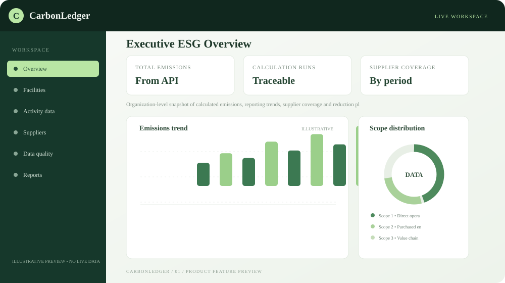
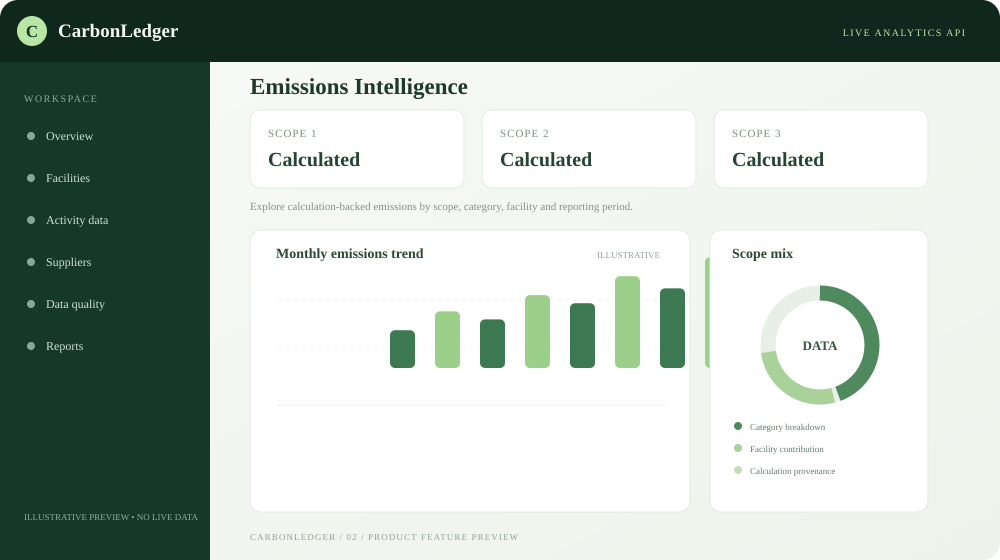
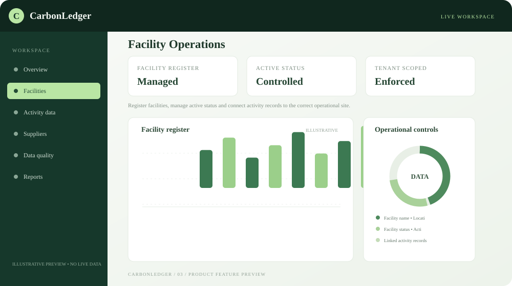
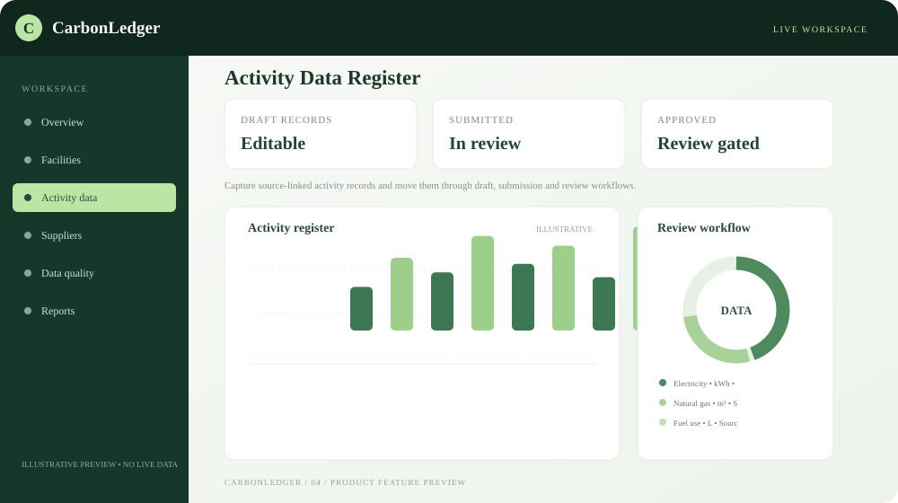
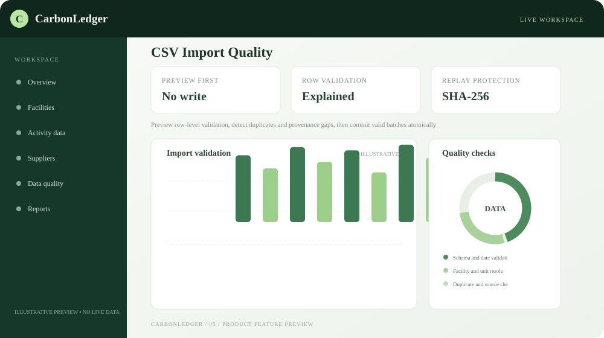
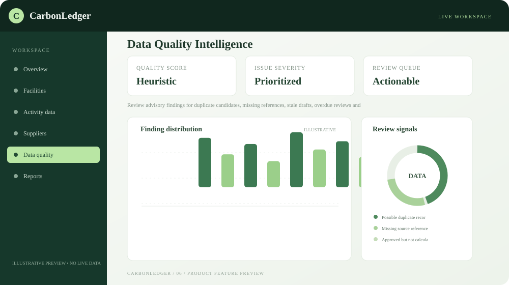
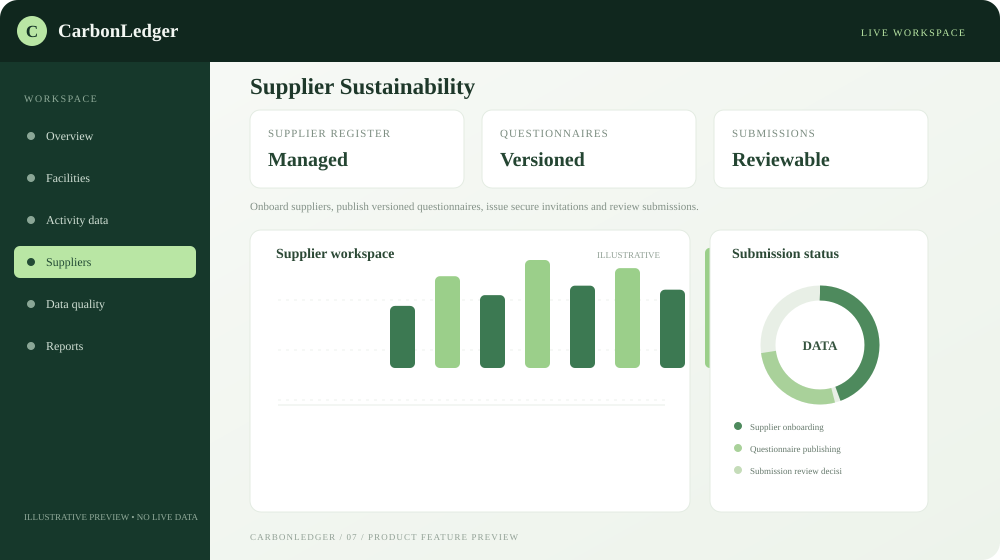
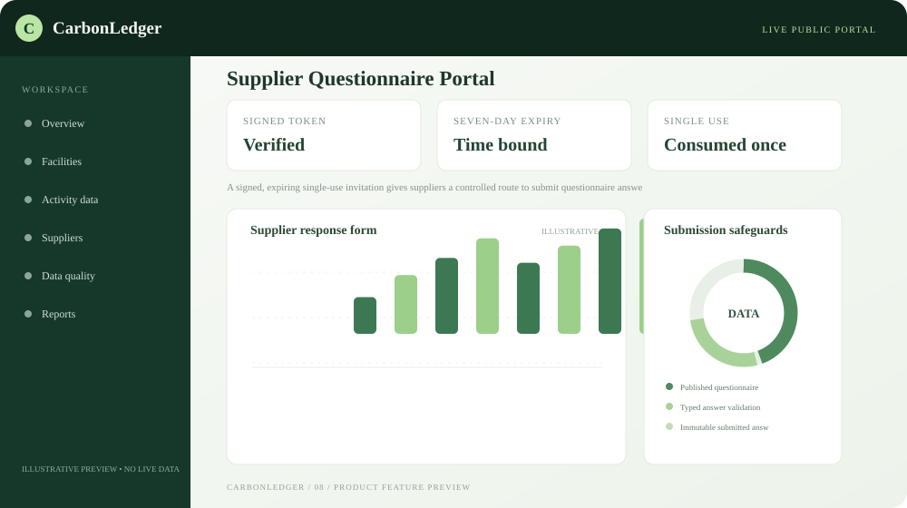
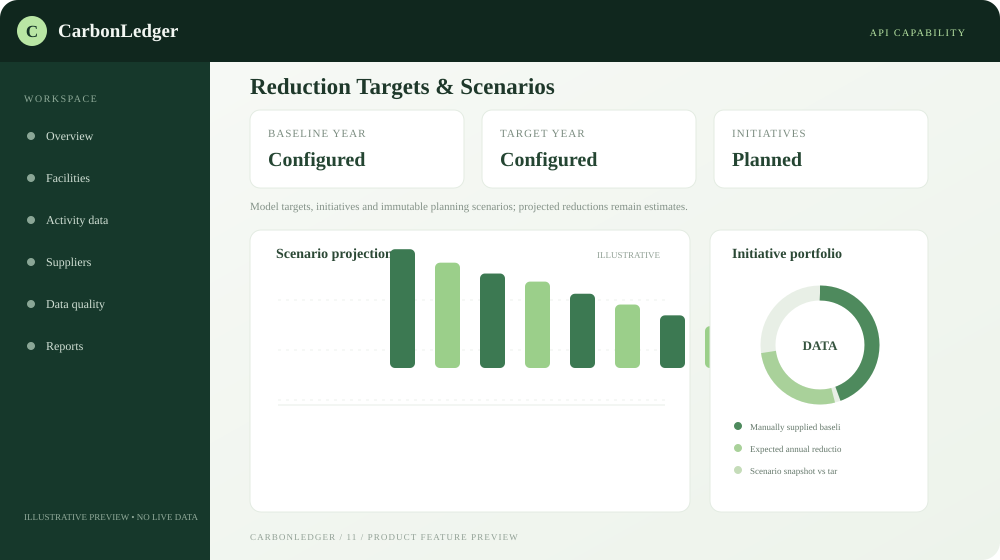

<div align="center">

# CarbonLedger

### Enterprise ESG • Carbon Accounting • Sustainability Intelligence

**Measure emissions. Govern data. Build a credible path to reduction.**

A full-stack PERN + TypeScript platform for organization-scoped activity data, traceable CO₂e calculations, supplier engagement, sustainability reporting and audit workflows.

[](https://github.com/matiur25580/CarbonLedger-Enterprise-ESG-Carbon-Accounting-Platform/actions/workflows/ci.yml)


</div>

---

## Project at a glance

CarbonLedger is an engineering-focused ESG and carbon-accounting application. It helps teams capture operational activity, review source data, calculate emissions with versioned factors, engage suppliers, plan reduction initiatives and export reviewable records.

| Capability | Current implementation |
|---|---|
| Multi-tenant identity | Organization membership, role checks, PostgreSQL Row-Level Security |
| Activity operations | Facilities, source-linked activity records, submission and approval |
| Carbon calculations | Decimal arithmetic, unit conversion, factor validity and immutable snapshots |
| Data ingestion | CSV preview, row validation, duplicate detection and atomic commit |
| Supplier engagement | Versioned questionnaires, signed one-time invitations and submission review |
| Evidence workflow | Private S3-compatible upload, ClamAV scanning, SHA-256 verification, evidence-level approval history and short-lived authenticated download URLs |
| Reduction planning | Targets, initiatives and immutable planning scenarios |
| Analytics | Scope/category/facility/month summaries, supplier coverage and CSV exports |
| Data quality | Advisory score, severity filtering and record-level issue queue |
| Integrations | Encrypted webhook secrets, transactional outbox and retrying delivery worker |
| Audit | Tenant-scoped audit history and bounded CSV exports with SHA-256 digest |

> **Status:** The core API, authenticated dashboard and primary workspaces are implemented. Security hardening and pre-deployment readiness work continue. A passing CI run is a code-quality signal—not a production-readiness or compliance certification.

## Product showcase — 12 dashboard previews

The following illustrations use the CarbonLedger visual language and show how the platform's capabilities are organized. **They are illustrative UI previews, not screenshots of live customer data.** Each section states whether the corresponding capability is available in the current UI or API.

### 01 — Executive ESG overview
A consolidated view of calculated emissions, reporting trends, supplier submission coverage and reduction scenario snapshots.

<p align="center"></p>

**Implementation:** Live authenticated analytics dashboard. Values are loaded from the tenant-scoped analytics API; no demo emissions are fabricated.

### 02 — Emissions intelligence
Understand emissions across Scope 1, Scope 2 and Scope 3, with category, facility and monthly breakdowns backed by calculation snapshots.

<p align="center"></p>

**Implementation:** Live analytics API and overview visualizations. Emission factors must be supplied with authoritative source metadata by the organization.

### 03 — Facility operations
Organize operational sites and connect activity data to the correct facility and reporting context.

<p align="center"></p>

**Implementation:** Facility workspace supports creation, listing and activation controls. Advanced facility benchmarking is not yet implemented.

### 04 — Activity data register
Capture electricity, fuel, materials and other activity records with source references and controlled review states.

<p align="center"></p>

**Implementation:** Live activity workspace with draft editing, submission, role-based approval/rejection and calculation actions. Current register loads up to 100 records.

### 05 — CSV import quality
Preview a file before writing, inspect row-level validation and duplicate findings, then commit an accepted batch atomically.

<p align="center"></p>

**Implementation:** Live CSV preview/commit flow with strict validation, 1 MiB / 500-row limits and SHA-256 replay protection.

### 06 — Data quality intelligence
Prioritize possible duplicates, missing source references, stale drafts, overdue reviews, uncalculated approvals and statistical outliers.

<p align="center"></p>

**Implementation:** Live data-quality workspace and API. Its 0–100 score is heuristic; findings are advisory and never auto-edit source records.

### 07 — Supplier sustainability workspace
Manage supplier onboarding, questionnaire versions, invitation workflows and submitted responses in one place.

<p align="center"></p>

**Implementation:** Live supplier workspace. Invitation URLs are currently distributed manually; automated email delivery is not implemented.

### 08 — Supplier questionnaire portal
Give suppliers a controlled, token-based experience to complete published sustainability questionnaires.

<p align="center"></p>

**Implementation:** Live public portal with signed, seven-day, single-use invitations and server-side answer validation.

### 09 — Evidence and review trail
Track evidence references, review decisions and the history associated with supplier submissions.

<p align="center"></p>

**Implementation:** Private S3-compatible uploads, queued ClamAV scanning, SHA-256 verification and short-lived authenticated downloads are implemented. Storage and scanner services require external configuration.

### 10 — Emission-factor catalogue
Govern factor source, version, geography, unit, methodology and effective dates to make calculations reproducible.

<p align="center"></p>

**Implementation:** Live authenticated catalogue workspace with source, version, geography, unit, methodology and validity filters; OWNER/ADMIN draft creation; and publish/retire lifecycle controls. No official factor dataset is bundled.

### 11 — Reduction targets and scenarios
Compare manually defined baselines and target thresholds with planned initiative portfolios and scenario projections.

<p align="center"></p>

**Implementation:** Live reduction-planning workspace for target creation, initiative tracking, status changes and immutable scenario snapshots. Projections are planning estimates—not measured reductions—and do not automatically recalculate from inventory activity.

### 12 — Audit and reporting
Inspect tenant-scoped audit events and export bounded emissions or audit records with integrity checks.

<p align="center"></p>

**Implementation:** Audit and reporting APIs are implemented; emissions CSV export is available from the analytics workspace. The audit digest validates the exported bytes but is not a persisted hash chain or independent timestamp.

---

## Technology stack

| Layer | Technology |
|---|---|
| Frontend | React 19, TypeScript, Vite |
| Backend | Node.js 22+, Express 5, TypeScript |
| Database | PostgreSQL 17 |
| Data access | Prisma ORM and migrations |
| Validation | Zod |
| API style | Versioned REST under `/api/v1` |
| Security | Helmet, CORS allowlist, HttpOnly refresh cookies, JWT access tokens, rate limits |
| Multi-tenancy | PostgreSQL RLS and organization-scoped authorization |
| Background processing | Node worker, transactional outbox, webhook retries |
| Local development | pnpm workspace and Docker Compose |
| CI | GitHub Actions: typecheck, lint, test and build |

## Architecture

CarbonLedger follows a modular-monolith approach: one TypeScript API organized by domain, one React application, PostgreSQL as the system of record, and a separately runnable worker for asynchronous webhook delivery.

```text
carbonledger/
├── apps/
│   ├── web/                 # React + TypeScript + Vite
│   └── api/                 # Express API, Prisma schema and worker
├── infra/
│   └── postgres/            # Local PostgreSQL role initialization
├── docs/
│   ├── architecture/        # System design and decisions
│   ├── domain/              # Domain behavior and API notes
│   ├── operations/          # Operator and pre-deployment runbooks
│   ├── product/             # Product scope and workspace notes
│   └── security/            # Threat model and security controls
├── .github/workflows/       # CI quality gates
├── docker-compose.yml
└── pnpm-workspace.yaml
```

### Engineering principles

- **Tenant isolation by design:** tenant context is derived server-side; PostgreSQL RLS provides defense in depth.
- **Reproducible calculations:** Decimal arithmetic, explicit unit conversions, date-valid factors and immutable provenance snapshots.
- **Review before trust:** activity and supplier data use explicit review states and append-only decisions.
- **No invented emissions:** no bundled placeholder factors or fabricated customer metrics.
- **Clear data boundaries:** calculated emissions, supplier coverage, planning estimates and heuristic quality findings are reported as different concepts.
- **Secure-by-default integration:** encrypted webhook secrets, signed payloads, destination validation and at-least-once delivery semantics.

## Quick start

### Prerequisites

- Node.js 22 or newer
- Corepack with pnpm 10
- Docker Engine / Docker Desktop with Compose

### 1. Clone and install

```bash
git clone https://github.com/matiur25580/CarbonLedger-Enterprise-ESG-Carbon-Accounting-Platform.git
cd CarbonLedger-Enterprise-ESG-Carbon-Accounting-Platform
corepack enable
pnpm install
```

> The repository currently has no committed pnpm lockfile. Run the manually triggered [Bootstrap pnpm lockfile workflow](https://github.com/matiur25580/CarbonLedger-Enterprise-ESG-Carbon-Accounting-Platform/actions/workflows/bootstrap-lockfile.yml) on `main`. It generates the lockfile without lifecycle scripts, verifies a frozen install, runs the database-backed quality checks, then commits the lockfile and switches regular CI to frozen installs. Until that workflow succeeds, dependency resolution is not fully reproducible.

### 2. Configure local environment

```bash
cp .env.example .env
```

Review every variable in `.env.example`. The sample credentials are for local development only—never reuse them in a hosted environment.

### 3. Start PostgreSQL and prepare Prisma

```bash
pnpm db:up
pnpm db:generate
pnpm db:migrate
```

The local Compose initialization provisions a bootstrap administrator, a migration role and a restricted application role. The API uses `APP_DATABASE_URL`; Prisma migrations use `DATABASE_URL`; `DATABASE_ADMIN_URL` is reserved for local provisioning and test cleanup. For an existing initialized volume, apply `infra/postgres/init/01-application-role.sql` as a database administrator if the restricted roles have not been created.

### 4. Run the application

```bash
pnpm dev
```

| Service | Local URL |
|---|---|
| Web application | http://localhost:5173 |
| API liveness | http://localhost:4000/api/v1/health/live |
| API readiness | http://localhost:4000/api/v1/health/ready |
| API metadata | http://localhost:4000/api/v1/meta |

### Useful commands

```bash
pnpm typecheck
pnpm lint
pnpm test
pnpm build
pnpm db:studio
pnpm --filter @carbonledger/api dev:worker
```

## API capability map

| Domain | Representative endpoints |
|---|---|
| Authentication | `/api/v1/auth` |
| Organizations and membership | `/api/v1/organizations` |
| Facilities | `/api/v1/facilities` |
| Activity records | `/api/v1/activity-records` |
| Emission factors | `/api/v1/emission-factors` |
| Calculations | `/api/v1/calculations` |
| CSV imports | `/api/v1/activity-imports` |
| Suppliers and portal | `/api/v1/suppliers` |
| Reduction planning | `/api/v1/reductions` |
| Analytics and data quality | `/api/v1/analytics` |
| Webhooks | `/api/v1/webhooks` |
| Audit events | `/api/v1/audit` |

All organization-facing endpoints require authentication and enforce organization scope, except the explicitly token-protected public supplier portal routes. See the domain documentation for request/response details and role requirements.

## Security and operational controls

Implemented controls include tenant-aware authorization, PostgreSQL RLS, HttpOnly refresh-cookie sessions, role-based review actions, Helmet security headers, explicit CORS origin, layered API rate limits, immutable calculation/factor snapshots, audit events, encrypted webhook secrets and destination-safe webhook delivery.

Recent hardening also adds request correlation IDs and privacy-conscious structured HTTP logs. Logs intentionally omit raw URLs, query strings, request bodies, authorization headers, IP addresses and user identifiers. This is an application logging baseline—not a substitute for centralized log retention, alerting, metrics or error tracking.

### Pre-deployment gates

Deployment is intentionally left to the repository owner. Before manually deploying, complete every relevant item in **[the pre-deployment readiness checklist](docs/operations/pre-deployment-readiness.md)**, including:

- Run the [lockfile bootstrap workflow](https://github.com/matiur25580/CarbonLedger-Enterprise-ESG-Carbon-Accounting-Platform/actions/workflows/bootstrap-lockfile.yml); confirm it commits `pnpm-lock.yaml` and switches CI to `pnpm install --frozen-lockfile`.
- Apply the shared rate-limit migration and set `RATE_LIMIT_STORE=postgres` on every API replica before horizontal scaling.
- Set production secrets, TLS, proxy trust, CORS and restricted database roles.
- Configure backups and complete a restore rehearsal.
- Provide private object storage, malware scanning and secure evidence delivery.
- Configure Resend, a verified sender, and `SUPPLIER_EMAIL_ENCRYPTION_KEY` on API and worker processes if email delivery is required.
- Add centralized observability, alerting and incident response ownership.
- Complete independent security review and production-like smoke tests.

## Known limitations — stated transparently

- No official emission-factor dataset is bundled; organizations must load validated, source-backed factors.
- Scope 3 coverage depends on configured categories and available supplier/activity data.
- The evidence vault requires private S3-compatible storage and a reachable ClamAV daemon. The PostgreSQL-backed scan worker uses retries and lease recovery; each active scan buffers at most 50 MiB.
- Supplier invitation email delivery uses an encrypted PostgreSQL queue and Resend when configured; delivery status is provider-acceptance status, not proof of inbox delivery. Without provider credentials, the existing manual-link fallback remains available.
- Activity and supplier submission lists have current first-page limits and need cursor pagination for larger tenants.
- Reduction baselines are manually supplied; scenario projections are estimates, not verified realized reductions.
- Data-quality scoring is heuristic and advisory, not a formal assurance opinion.
- Audit CSV SHA-256 is a file-integrity digest, not a tamper-evident hash chain or third-party timestamp.
- API rate limits support process-local memory or a shared PostgreSQL counter store; configure `RATE_LIMIT_STORE=postgres` on every API replica after applying the shared-store migration.
- Centralized metrics, tracing, alerting, lockfile-based reproducibility and independent penetration testing remain release gates.

## Roadmap

- [x] Foundation, workspace and local PostgreSQL infrastructure
- [x] Identity, organizations, roles and tenant isolation
- [x] Facilities, activity records and emission-factor APIs
- [x] Deterministic calculation engine and immutable snapshots
- [x] CSV import preview, validation and commit
- [x] Supplier questionnaires and secure invitation portal
- [x] Evidence metadata and append-only review decisions
- [x] Reduction targets, initiatives and scenario APIs
- [x] Analytics, emissions exports and audit exports
- [x] Webhook outbox and delivery worker
- [x] Authenticated dashboard, activity, facility and supplier workspaces
- [x] Data-quality intelligence workspace
- [x] Request correlation IDs and structured HTTP logs
- [ ] Lockfile and frozen CI installation
- [x] Shared PostgreSQL rate-limit store implementation (migration and production configuration still required)
- [ ] Production observability integrations
- [x] Private evidence upload, ClamAV scanning and secure download API (external storage/scanner configuration required)
- [x] Durable asynchronous evidence scanning with retries and lease recovery
- [x] Supplier invitation email queue, encrypted payloads, Resend delivery and retry/status tracking (provider configuration required)
- [ ] Independent security review and deployment validation

## Documentation

- [System design](docs/architecture/system-design.md)
- [Product scope](docs/product/mvp-scope.md)
- [Web dashboard](docs/product/web-dashboard.md)
- [Activity data workspace](docs/product/activity-data-workspace.md)
- [Supplier workspace](docs/product/supplier-workspace.md)
- [Calculation engine](docs/domain/calculation-engine.md)
- [Data quality and reporting](docs/domain/analytics-and-reporting.md)
- [Webhook delivery worker](docs/domain/webhook-delivery-worker.md)\n- [Supplier invitation email delivery](docs/security/supplier-invitation-email.md)
- [Identity and tenancy security](docs/security/identity-and-tenancy.md)
- [API abuse controls](docs/security/api-abuse-controls-and-dependency-hardening.md)
- [Pre-deployment checklist](docs/operations/pre-deployment-readiness.md)

## Project boundary

CarbonLedger is a software engineering project and demonstration. It is not an accredited GHG assurance service, legal opinion, compliance certification or guarantee of regulatory acceptance. Framework-aligned workflows do not replace qualified methodology selection, evidence verification, professional review or external assurance.

## License

No open-source license has been selected. Until a license is added, all rights are reserved by the repository owner.
